# 面向混合长短请求的 LLM 推理准入与尾延迟控制系统

本科毕业设计项目，研究同一 LLM 推理实例混合处理交互请求与后台任务时的准入与尾延迟控制。计划基于 llama.cpp 实现 C++ 调度扩展，结合输出长度估计、在线误差校准、软工作量预算和后台老化，评估交互请求 P95 首 token 延迟、吞吐及后台完成代价。

当前仓库处于方案与预实验准备阶段，包含研究和开发文档及文档维护工具，尚未包含推理系统实现或尾延迟实测结果。

2026-10-19 已完成 P0 第一步（环境冻结、引擎固定与 CUDA 构建、模型加载、脚本化流式冒烟、源码定位），详见[每日记录 20261019](daily/20261019/README.md)与[实施计划](docs/implementation-plan.md)。冒烟仅用于核对链路与计时口径，不构成性能结论。

## 任务流程与当前进度

下图是项目全景：**P0→P7 八个阶段 + G0—G6 七个决策门**，箭头表示推进顺序与门后分支。

```mermaid
flowchart TD
    NOW["▲ 当前进度：P0 第二步起点<br/>第一步已完成（环境/引擎/模型/冒烟/源码定位）<br/>下一步：回放器 → E0/E1"]

    subgraph P0["P0 文献与可行性 · 10-19 → 11-08"]
        A1["✔ 环境冻结<br/>WSL2 · CUDA 12.6 · RTX 3050 Ti"]
        A2["✔ 引擎固定 llama.cpp v0.7.0<br/>SHA 620d2225"]
        A3["✔ 模型 Qwen2.5-1.5B Q4_K_M<br/>SHA256 6a1a2eb6"]
        A4["✔ 冒烟：交互 + 后台流式请求<br/>逐块计时 · 每条独立文件"]
        A5["✔ 源码定位表<br/>7 条链路 · 15 个接入点"]
        A6["▶ 回放器（开放到达）<br/>计划到达表 · 发送滞后 · 逐块时间戳"]
        A7["prestudy E0<br/>200 条交互 × 3 次重复"]
        A8["prestudy E1<br/>同轨迹 + 约 100 条后台"]
        Q0{"G0 门<br/>现象 / 测量 / 接入可行性"}
        A1 --> A2 --> A3 --> A4 --> A5 --> A6 --> A7 --> A8 --> Q0
    end

    subgraph P1["P1 需求与预注册 · 11-09 → 11-29"]
        B1["冻结 R01—R08、唯一主场景<br/>数据划分 · SLO · 种子 · 重复规模"]
        B2["正式实验矩阵与机时表"]
        Q1{"G1 门<br/>预注册冻结"}
        B1 --> B2 --> Q1
    end

    subgraph P2["P2 设计与开题 · 11-30 → 12-20"]
        C1["状态机 · 硬容量预留 · 软工作量<br/>误差校准 · 后台保护 · 回收接口"]
        C2["R08 动态 prefill 控制点验证<br/>保留 / 删除决策"]
        Q2{"G2 门<br/>容量与回收闭合"}
        C1 --> C2 --> Q2
    end

    subgraph P3["P3 基线与观测 · 12-21 → 01-17"]
        D1["B0 原始引擎 / B1 公共硬守卫"]
        D2["事件插桩与观测<br/>到达 · 排队 · 首 token · 终态"]
        D3["小轨迹对账 · 硬守卫代价"]
        Q3{"G3 门<br/>基线可观测"}
        D1 --> D2 --> D3 --> Q3
    end

    subgraph P4["P4 核心策略 · 01-18 → 02-28"]
        U1["长度估计器 + 在线误差校准"]
        U2["软准入 + 后台老化"]
        U3["对照：B2-P / B2-Q / B3 / B4 / 最近邻 NN"]
        U4["组合策略 M + 必要消融"]
        Q4{"G4 门<br/>决策介入 · 硬软隔离 · 后台服务"}
        U1 --> U2 --> U3 --> U4 --> Q4
    end

    subgraph P5["P5 测试与实验 · 03-01 → 03-28"]
        V1["工程验收 acceptance-E1—E7"]
        V2["正式对照矩阵 · 消融 · 鲁棒性"]
        V3["统计与报告（配对 Δ、区间、终态闭合）"]
        Q5{"G5 门<br/>03-31 数据冻结"}
        V1 --> V2 --> V3 --> Q5
    end

    subgraph P6["P6 论文修订 · 04-01 → 04-25"]
        W1["论文整合 · 结果与图表 · 修改与格式"]
    end

    subgraph P7["P7 归档与答辩 · 04-26 → 05-16"]
        X1["归档复核 · 演示材料 · 答辩"]
        Q6{"G6 门<br/>交付核对"}
        X1 --> Q6
    end

    Q0 --> B1
    Q1 --> C1
    Q2 --> D1
    Q3 --> U1
    Q4 --> V1
    Q5 --> W1 --> X1

    NOW -.->|"下一步开工"| A6

    classDef done fill:#d1e7dd,stroke:#198754,color:#0a3622;
    classDef current fill:#fff3cd,stroke:#fd7e14,stroke-width:3px,color:#664d03;
    classDef todo fill:#eef1f5,stroke:#9aa5b1,color:#374151;
    classDef gate fill:#e7e9f7,stroke:#5b6ee1,color:#1f2a63;
    classDef nowbox fill:#ffe8a3,stroke:#fd7e14,stroke-width:2px,color:#5c3d00;
    class A1,A2,A3,A4,A5 done;
    class A6 current;
    class A7,A8,B1,B2,C1,C2,D1,D2,D3,U1,U2,U3,U4,V1,V2,V3,W1,X1 todo;
    class Q0,Q1,Q2,Q3,Q4,Q5,Q6 gate;
    class NOW nowbox;
```

**图例**：🟩 已完成 ｜ 🟨 当前/下一步 ｜ ⬜ 未开始 ｜ 🟪 菱形为决策门（G0—G6，判定不过则调整或缩小范围）。

| 阶段 | 时间 | 状态 | 关键交付 / 门槛 |
|---|---|---|---|
| P0 第一步 | 10-19 | ✅ 已完成 | 环境记录、引擎与模型固定、冒烟核对、源码定位表 |
| **P0 第二步** | 至 11-08 | **▶ 下一步** | 开放到达回放器；小轨迹核对；E0（200×3）/ E1（+100 后台）；→ **G0** |
| P1 | 11-09 → 11-29 | 未开始 | 需求与实验冻结、正式矩阵与机时 → G1 |
| P2 | 11-30 → 12-20 | 未开始 | 状态机/容量/接口设计、R08 去留 → G2 |
| P3 | 12-21 → 01-17 | 未开始 | B0/B1 基线、事件插桩、小轨迹对账 → G3 |
| P4 | 01-18 → 02-28 | 未开始 | 校准、软准入、老化、对照与组合策略 M → G4 |
| P5 | 03-01 → 03-28 | 未开始 | 验收 E1—E7、正式对照、消融、统计 → G5（03-31 冻结） |
| P6 | 04-01 → 04-25 | 未开始 | 论文整合、结果与图表、修改格式 |
| P7 | 04-26 → 05-16 | 未开始 | 归档复核、演示、答辩 → G6 |

> 进度以本图与上表为准：每次阶段推进时同步更新（并在 `daily/` 记录当天依据）。

## 记录分工（单一来源，避免重复）

同一事实只在一处维护，其他文档只引用不复制：

| 内容 | 唯一权威位置 |
|---|---|
| 环境实测值、版本与 SHA、构建/启动命令、问题处置 | [docs/environment.md](docs/environment.md) |
| 分步任务、完成判据、执行记录、后续启动清单 | [docs/implementation-plan.md](docs/implementation-plan.md) |
| 固定引擎的源码定位（文件:行号、接入点、可观测口径） | [docs/source-map.md](docs/source-map.md) |
| 引擎版本与克隆方式 | `third_party/README.md` + `results/raw/prestudy/<date>-build/clone-record.md` |
| 单次实验的原始数据与分析结论 | `results/raw/<stage>/<run_id>/README.md` + `manifest.json` |
| 运行状态索引（哪个是正式证据、哪个被取代） | [results/README.md](results/README.md) |
| 当天做了什么、人时、问题与下一步 | `daily/<YYYYMMDD>/README.md`（索引见 [daily/README.md](daily/README.md)） |
| 工具用法与计时口径 | [scripts/replay/README.md](scripts/replay/README.md) |
| 同步、一致性检查、每日收尾 | [scripts/ops/README.md](scripts/ops/README.md) |

## 文档导航

| 文档 | 用途 |
|---|---|
| [开题报告](开题报告_面向混合长短请求的LLM推理准入与尾延迟控制系统.md) | 研究问题、系统设计、实验目标和参考文献 |
| [开发流程计划](开发流程计划_面向混合长短请求的LLM推理准入与尾延迟控制系统.md) | 进度、人时、决策门、验收和需求追踪 |
| [预实验方案](预实验方案_干扰复现与干预探针.md) | 先执行 E0/E1，再按数据选择补测 |
| [实施计划](docs/implementation-plan.md) | 分步执行清单、第一步执行记录、后续启动清单 |
| [环境记录](docs/environment.md) | 环境实测值、版本与 SHA、构建与启动命令 |
| [源码定位](docs/source-map.md) | 固定引擎的接入/队列/slot/prefill/取消/回收定位 |
| [每日记录](daily/) | **按日期的工作日志与成果**（`daily/<YYYYMMDD>/README.md` + 自动生成的 `产出清单.md`），索引见 `daily/README.md` |
| [运行索引](results/README.md) | prestudy 各次运行的性质、状态与取代关系 |
| [运维脚本](scripts/ops/README.md) | 单向同步、双副本一致性检查、每日收尾（`eod.sh`） |

建议按“开题报告 → 开发流程计划 → 预实验方案”的顺序阅读。

## 开始实施

执行入口为 [分步骤实施计划](docs/implementation-plan.md)，其中包含第一步检查清单、后续阶段交付与目录用途。

第一步先在 WSL 中完成固定版本原始引擎的构建、模型加载和两类流式请求核对，填写 [环境记录](docs/environment.md) 和 [源码定位](docs/source-map.md)；随后开展小轨迹核对及 E0/E1 预实验。

已建立 C++ 模块、配置、回放/分析、测试和数据产物目录。当前 `CMakeLists.txt` 仅为目录配置骨架，不生成推理程序；配置清单是待填写模板，尚无可运行的调度系统、回放器或实测结果。目录说明见实施计划及各目录 README。

## 文档维护

GitHub 仓库以 Markdown 为内容源。Word（`.docx`）仅在本地保留，用于提交材料，已通过 `.gitignore` 排除；克隆当前版本不会获得 Word 文件。

[`tools/`](tools/README.md) 提供 Markdown 到 Word 的同步与排版检查工具，依赖本地已有的同名 Word 模板和配置好的 Python、LibreOffice 等环境。修改 Markdown 后，如需更新本地 Word，可按工具说明同步、渲染并逐页检查。当前工具配置包含本机路径，其他设备使用前需要调整。
