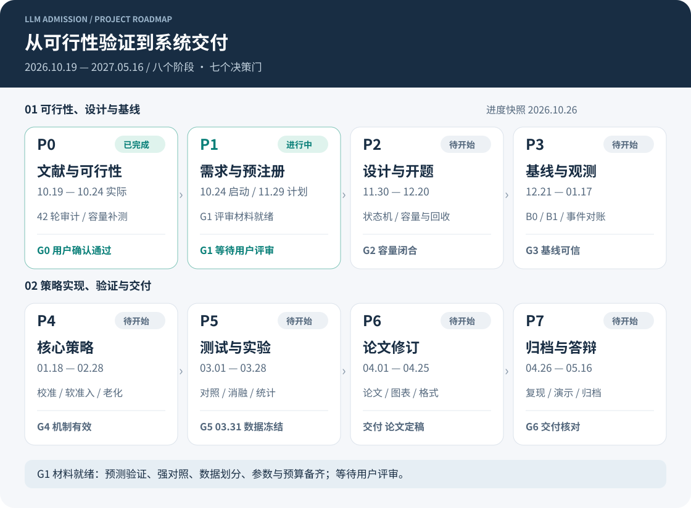
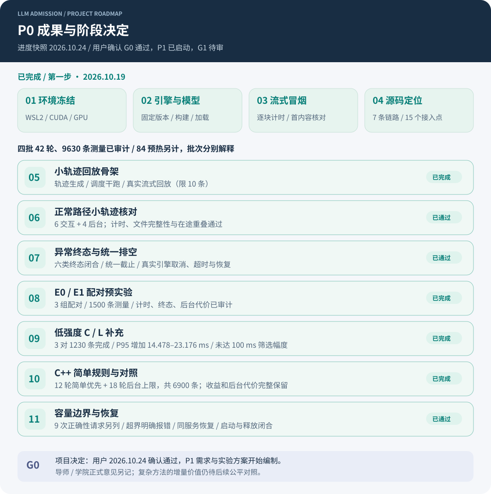

# 面向混合长短请求的 LLM 推理准入与尾延迟控制系统

本科毕业设计项目，研究同一 LLM 推理实例混合处理交互请求与后台任务时的准入与尾延迟控制。已基于 llama.cpp 实现独立 C++ 交互优先、后台老化与后台上限原型；继续原课题的同信息固定余量 B3 与在线校准 M 增量比较，评估等待、吞吐、后台完成及方法成本。简单规则作为必要对照与适用边界。

当前处于 **P1需求与实验方案阶段（2026-10-24启动）**：用户已明确确认[G0评审通过](docs/reviews/20261024-g0-decision.md)，P0结束，P1提前启动，G1尚未评审或冻结。已开始编制[需求、场景、实验协议和矩阵预算](docs/p1/README.md)。原题的M/B3增量主比较保留，尚未实现比较或证明复杂算法价值；导师/学院正式意见另记。用户已指示人工工时待成果后补，不作为当前推进阻塞；自动运行时间据实记录。

**10-24真实开发测试已完成**：WSL运行9轮2010条测量，另24校准、20预热，全部完成，单调耗时20.02分钟。聊天P95：突发3.759—3.957秒，平缓0.779—1.090秒，稀疏0.200—0.238秒；38份冻结来源及运行库/模型一致，独立审计通过。另发现部分临时预测已达输出上限、QBA草案分类退化，须在G1前处理，未据此宣布算法收益。[白话结果](docs/reports/20261024/P1开发测试结果与下一步.md)、[九轮数据](docs/experiments/20261024-025138-p1-development-validation-v1/README.md)、[预测空间诊断](docs/experiments/20261024-025138-p1-development-validation-v1/diagnostics-v1/README.md)。

P0四个完整批次共42轮、9630条测量，84条预热另计，新增9次容量正确性请求另列，均按原口径保存。过程和数据见[G0白话实验材料](docs/reports/20261023/G0评审材料_实验完成版.md)；其中空白评审表是决定前快照，最新状态以[G0决定记录](docs/reviews/20261024-g0-decision.md)为准。另见[最近邻重合边界](docs/reports/20261023/G0最近邻核对与原课题边界.md)及[18轮数据](docs/experiments/20261023-151822-p0-background-cap-v1/README.md)。失败和负面结果保留。

**10-23 下午验证已完成**：同一新引擎比较原路径、简单优先、简单优先加“后台最多同时一条”，两种到达形状各三个重复，18 轮 4140 条全部完成，单调时钟批次耗时约 52.87 分钟。六个新增上限的主对照均达到聊天目标，也均超过 20% 后台和 5% 速率代价线。判断线见[采前冻结协议](docs/prestudy-background-cap-protocol-v1.md)；它们不是用户业务 SLO 或 G0 自动通过条件。

2026-10-19 已完成 P0 第一步（环境冻结、引擎固定与 CUDA 构建、模型加载、脚本化流式冒烟、源码定位），详见[每日记录 20261019](daily/20261019/README.md)与[实施计划](docs/implementation-plan.md)。冒烟仅用于核对链路与计时口径，不构成性能结论。

## 项目架构：从现状到目标设计

系统计划在 llama.cpp 执行请求之前增加 C++ 控制层，决定请求何时进入执行，并兼顾交互等待、吞吐与后台完成代价。**当前已有回放、测量、审计链路及独立简单队列原型；图中完整软准入、校准、硬账本和生命周期适配仍属于候选目标设计，不代表已经实现或确定都需要。**

硬容量判断“能不能放得下”，按实际输入与最大输出保守预留；软预算判断“现在是否太忙”，预测只参与软决策，不能缩减硬预留。后台等待达到阈值后进入保护集合，但仍须满足硬约束。图示说明设计，不代表策略已经验证有效。

① 当前已经运行的实验与证据链

这张链路图保留 10-21 的原始引擎实验快照；10-23 的新对照直接访问同一修改后引擎，以开关比较原队列路径与简单规则。完整原始记录默认仅在本机保存，报告和摘要不替代原始证据。

③ 一条请求为什么放行、等待或拒绝（目标流程）

永久不可容纳按规则拒绝；暂时容量不足继续等待；软预算超限且无预定例外时延后接纳。停止、清理并确认槽位安全后，才一次性归还硬账本。流程仍待实现，具体优先级和阈值需后续冻结。

推荐先读 [架构阅读指南与术语解释](docs/architecture/README.md)，再看各图。交互版入口为 [index.html](docs/architecture/index.html)：下载或克隆仓库后，用浏览器打开该文件，即可切换三张图、缩放、查看来源并导出。GitHub 仓库页面只展示 HTML 源码，不直接运行交互版。

## 任务流程与当前进度

项目分 **P0—P7八个阶段**，设 **G0—G6七个决策门**。下图为2026-10-24进度：用户确认G0通过，P0完成，P1进行中，G1待审。P1实际提前至10-24启动，其余日期保留原计划窗口，跨年阶段延续至2027年。

图中绿色表示进行中或已完成的工作（以状态文字为准），灰色表示待开始。图为静态进度快照，不使用随日期移动的“今日线”。决策门未通过时，按《开发流程计划》§4.3 调整并复验。

SVG 源文件位于 [`docs/images/`](docs/images/)，可直接编辑；也可修改 [`tools/render_readme_diagrams.py`](tools/render_readme_diagrams.py) 后运行 `python tools/render_readme_diagrams.py` 重新生成。阶段推进时同步更新图、下表和实施计划，并在 `daily/` 留存依据。

| 阶段 | 时间 | 状态 | 关键交付 / 门槛 |
|---|---|---|---|
| P0 第一步 | 10-19 | ✅ 已完成 | 环境记录、引擎与模型固定、冒烟核对、源码定位表 |
| **P0 第二步** | 实际至10-24 | **✅ G0项目评审通过** | 用户明确决定；四批42轮9630条已审计、9次容量补测完成，导师/学院正式记录另记 |
| **P1** | 实际10-24启动；原计划11-09 → 11-29 | **▶ 开发验证已完成，方案继续修订** | 9轮2010条+24校准+20预热通过；校准/NN分界须完善，G1未冻结 |
| P2 | 11-30 → 12-20 | 未开始 | 状态机/容量/接口与软决策介入条件；R08 默认不纳入 → G2 |
| P3 | 12-21 → 01-17 | 未开始 | B0/B1 基线、事件插桩、小轨迹对账 → G3 |
| P4 | 01-18 → 02-28 | 未开始 | 校准、软准入、老化、对照与组合策略 M → G4 |
| P5 | 03-01 → 03-28 | 未开始 | 验收 E1—E7、正式对照、消融、统计 → G5（03-31 冻结） |
| P6 | 04-01 → 04-25 | 未开始 | 论文整合、结果与图表、修改格式 |
| P7 | 04-26 → 05-16 | 未开始 | 归档复核、演示、答辩 → G6 |

### 下一阶段先做什么

按[P1工作台](docs/p1/README.md)完善唯一主场景、评价标准、数据划分、参数选择、独立重复和成本。已测固定后台上限作为辅助强对照保留，不替代固定服务配额。人工工时按用户指示待成果后补，程序运行时间保留真实日志。

新场景的实际输入与短窗口负载已测；下一项先完善校准与长短分界，避免余量被上限裁平或最近邻全部归短，再进入G1审查。当前不把2010条开发数据计为M/B3正式对照。

P1通过G1后冻结方案；后续G2/G3先核对M/B3实际介入机会，再推进完整实现和价值比较。历史P0数据不重跑凑数，不作为未接触的最终测试。

## 记录分工（单一来源，避免重复）

同一事实只在一处维护，其他文档只引用不复制：

| 内容 | 唯一权威位置 |
|---|---|
| 环境实测值、版本与 SHA、构建/启动命令、问题处置 | [docs/environment.md](docs/environment.md) |
| 分步任务、完成判据、执行记录、后续启动清单 | [docs/implementation-plan.md](docs/implementation-plan.md) |
| 固定引擎的源码定位（文件:行号、接入点、可观测口径） | [docs/source-map.md](docs/source-map.md) |
| 引擎版本与克隆方式 | `third_party/README.md` + `results/raw/prestudy/<date>-build/clone-record.md` |
| 单次实验的原始数据与分析结论 | `results/raw/<stage>/<run_id>/README.md` + `manifest.json` |
| 运行状态索引（哪个是正式证据、哪个被取代） | [results/README.md](results/README.md) |
| 当天做了什么、人时、问题与下一步 | `daily/<YYYYMMDD>/README.md`（索引见 [daily/README.md](daily/README.md)） |
| 工具用法与计时口径 | [scripts/replay/README.md](scripts/replay/README.md) |
| 同步、一致性检查、每日收尾 | [scripts/ops/README.md](scripts/ops/README.md) |

## 文档导航

原 E0/E1 批次的历史通俗总结提供 [Markdown 源码](docs/reports/20261021/P0阶段总结与下一阶段安排.md)、[Word 下载](docs/reports/20261021/P0阶段总结与下一阶段安排.docx) 和 [原始样本及校验清单](docs/reports/20261021/data/)。内含逐请求数据、计算示例、名词解释及下一阶段安排；9份公开样本不替代本机完整实验档案。

| 文档 | 用途 |
|---|---|
| [开题报告](开题报告_面向混合长短请求的LLM推理准入与尾延迟控制系统.md) | V1.4（2026-10-21）：研究依据、拟采用方法与拟开展实验；不包含后续实验数据或已完成进展 |
| [开发流程计划](开发流程计划_面向混合长短请求的LLM推理准入与尾延迟控制系统.md) | V1.3：同步前置介入核对、分层矩阵、人时复核及默认范围 |
| [P0 实验复审与补充设计](docs/p0-experiment-review-minimal-supplement-20261021.md) | 已知证据、解释缺口、最小补充与可选探针；旧通用方案已融合 |
| [低强度补充执行协议](docs/prestudy-lowload-protocol-v1.md) | C/L 六轮配对、冻结阈值、完整终态与停止规则 |
| [实施计划](docs/implementation-plan.md) | 分步执行清单、第一步执行记录、后续启动清单 |
| [环境记录](docs/environment.md) | 环境实测值、版本与 SHA、构建与启动命令 |
| [源码定位](docs/source-map.md) | 固定引擎的接入/队列/slot/prefill/取消/回收定位 |
| [每日记录](daily/) | **按日期的工作日志与成果**（`daily/<YYYYMMDD>/README.md` + 自动生成的 `产出清单.md`），索引见 `daily/README.md` |
| [运行索引](results/README.md) | prestudy 各次运行的性质、状态与取代关系 |
| [运维脚本](scripts/ops/README.md) | 单向同步、双副本一致性检查、每日收尾（`eod.sh`） |

建议按“开题报告 → 开发流程计划 → P0 复审 → 对应批次协议和报告”的顺序阅读。开题报告中的 2026-10-19 是方案初稿编制日期，正式开题评审拟于 P2 按学院通知安排；文件修订日期如实保留。开题正文仅陈述研究方案，实际执行进展与结果按发生日期记录在本页、每日记录和实验报告中。修订后的开题方案不替代当时冻结的实验协议，也不能作为早于实际修订时间的预注册证据。通用回放字段及可选探针统一见 [回放说明](scripts/replay/README.md)。

## 开始实施

结果按日期留存：`daily/YYYYMMDD/` 保存工作记录与结果索引；`results/raw/prestudy/<含日期的run_id>/` 保存唯一运行证据；`results/archives/YYYYMMDD/` 保存含校验值的本地归档包。原始数据默认不入 Git，详见 [保留规则](results/README.md#论文证据保留与按日期归档)。

执行入口为 [分步骤实施计划](docs/implementation-plan.md)，其中包含第一步检查清单、后续阶段交付与目录用途。

第一步先在 WSL 中完成固定版本原始引擎的构建、模型加载和两类流式请求核对，填写 [环境记录](docs/environment.md) 和 [源码定位](docs/source-map.md)；随后的小轨迹、E0/E1 与低强度补充现已完成；历史入口仅供复现，新运行必须新建目录。

已建立 C++ 模块、配置、回放/分析、测试和数据产物目录。当前根目录 `CMakeLists.txt` 仍为目录配置骨架；可运行简单原型由[独立引擎补丁](patches/simple-priority-aging-v1/README.md)构建。已具备异步开放到达、六类终态、统一排空与后台持久化工具；完整软预算、在线校准、硬 KV 账本和最终测试仍未完成。目录说明见实施计划及各目录 README。

## 实验方法技能

项目安装了 [`scientific-critical-thinking`](.agents/skills/scientific-critical-thinking/SKILL.md)，来源为 [K-Dense Scientific Agent Skills](https://github.com/K-Dense-AI/scientific-agent-skills)，采用 MIT 许可证并固定上游提交。它用于实验设计、变量与对照、统计解释，以及论文方法和结论审查；[项目中文工作流](.agents/skills/scientific-critical-thinking/references/llm-project-workflow.md) 区分负载强度、长度分布和调度策略三个问题。[来源清单](.agents/skills/scientific-critical-thinking/SOURCE.json) 保留版本、原始校验值和适配说明。

可直接说：“使用 scientific-critical-thinking 技能，审查 P0 E0/E1 实验，给出最小补充对照方案，先写协议。”项目 `AGENTS.md` 已加入相关研究任务的读取入口；安装技能本身不会启动实验或推进阶段。

## 论文写作技能

项目安装了 [`scientific-writing`](.agents/skills/scientific-writing/SKILL.md)，用于中文本科论文、开题报告和研究章节的起草、改写、引用及方法—结果一致性核对。[项目论文工作流](.agents/skills/scientific-writing/references/project-thesis-workflow.md) 区分方案、实际执行记录和论文结果，保留真实修订日期，不将后验修订冒充原始预注册。来源与固定版本见 [SOURCE.json](.agents/skills/scientific-writing/SOURCE.json)，许可证为 MIT；随附检查工具离线运行，不需要 API 密钥。

可直接说：“使用 scientific-writing 技能，按本项目证据撰写论文绪论。”涉及实验设计或结论审查时配合 scientific-critical-thinking，Word/PDF 排版使用对应文档技能。

## 文档维护

项目每日收尾使用 [`$llm-project-daily`](skills/llm-project-daily/SKILL.md)：核对当天实际工作，更新日志与结果索引，按日期打包成果并校验，同步 README 进度表和两张进度图。可以直接说“按项目技能做今天收尾”。技能源文件随项目保存，个人技能目录中已安装可发现的副本；它不创建定时任务，也不自动提交或推送。

GitHub 仓库以 Markdown 为内容源。Word（`.docx`）默认在本地保留；P0 阶段总结按发布要求单独纳入版本管理，可从上方文档入口下载，其他材料仍按 `.gitignore` 排除。

[`tools/`](tools/README.md) 提供 Markdown 到 Word 的同步与排版检查工具，依赖本地已有的同名 Word 模板和配置好的 Python、LibreOffice 等环境。修改 Markdown 后，如需更新本地 Word，可按工具说明同步、渲染并逐页检查。当前工具配置包含本机路径，其他设备使用前需要调整。
