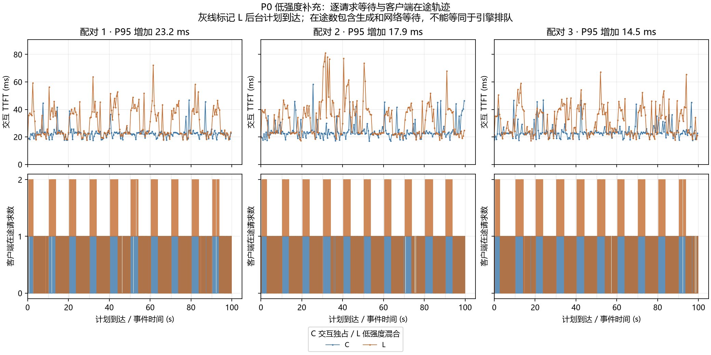

# P0 全量白话说明与 G0 评审表

整理日期：2026 年 10 月 22 日。完成事项和实验数据截至项目现有的 10 月 21 日记录；今天仅查阅、复算和整理材料，没有开展新实验。本文是供用户评审的材料，不代表用户或导师已经通过 G0。

**先说结论：P0 已经把“能跑、能按计划制造负载、能正确测量、能保留证据”这条链路打通，也完成了强负载和低强度两批预实验。12 轮共 2730 条测量请求全部完成，另有 24 条预热。自己的 C++ 调度系统还没实现，G0 仍待评审，P0 还不能标成全阶段完成。**

强负载下，交互请求 P95 从约 34–36 毫秒升到 111–124 秒；低强度下，P95 只增加约 14–23 毫秒。两种结果都要保留。现在最需要评审的是：后续到底针对什么有代表性的场景，为什么值得优化，和谁比较，学生与设备是否有足够时间完成。

## 阅读与证据约定

“已完成”指有现存记录支持；“建议”是本次提出的评审或后续安排；“待评审”由用户或导师作决定。脚本检查通过不等于人工评审通过。两批实验分别解释，不把它们拼成六对同期对照。

本次只读复核了两批 12 个 `client.jsonl` 和对应 2730 份逐请求 JSON：数量、唯一 ID、逐条记录与聚合内容闭合；用线性插值重新计算每轮 P50/P95，与既有摘要一致，仅有浮点尾数差异。低强度 CSV 的 1230 行 TTFT、输出量和终态也与原始 JSON 相符。这不是重新运行模型或完整复验所有历史测试。

## 一、这个项目和 P0，用大白话说是在干什么

可以把模型服务想成一家只有两个办理位置的窗口。有人问个短问题，正在屏幕前等答案；有人提交一项能等一会儿的长任务。它们共用同一台机器。我们准备研究怎样决定谁先进入、谁先等一下，以及怎样避免后台任务一直轮不上。

交互、后台是业务身份；长、短是工作量特征，不能画等号。本次交互输出上限较小，后台输出上限较大，但模型可能提前结束，实际长度必须另看记录。

P0 相当于先检查窗口能否开门、秒表是否准确、队伍能否按安排到达、账有没有漏记，再观察问题在哪些条件下出现。它没有完成后续的排队规则改造，也没有证明某种新算法能改善等待。

## 二、P0 到现在实际做过的事情

| 实际日期 / 工作 | 大白话说明 | 已留下的东西 / 怎么理解 |
|---|---|---|
| 10-19：整理计划和目录 | 把论文方案、开发阶段、代码、数据、运行证据分别放好，明确每一步的交付和评审门 | 开题方案、开发计划、实施计划、源码/配置/实验目录；这些属于计划与工程组织，不是性能结果 |
| 10-19：检查电脑与 WSL | 查显卡能否在 Linux 环境里使用，编译工具是否齐全，内存、磁盘够不够 | 环境版本、命令和原始输出；Windows 宿主为 16 GiB 内存，本次 WSL 可见约 7.7 GiB，两者不是同一口径 |
| 10-19：固定推理引擎并构建 | 选定一版 llama.cpp，打开 CUDA 支持，编出能运行的程序 | 固定提交、构建命令、日志和三个程序；构建约 12.8 分钟 |
| 10-19：准备模型并加载 | 选一个 4 GiB 显卡能容纳的量化模型，保存来源、许可证和文件指纹 | Qwen2.5-1.5B-Instruct Q4_K_M；约 1.1 GiB；文件 SHA256 已保存。它是本轮已验证可运行的模型，正式研究配置还要冻结 |
| 10-19：修正第一次冒烟的测量问题 | 最初把网络开始回包误当成模型开始输出，还出现一份流式文件被覆盖；随后改成逐块计时、每条独立文件 | v1 的问题和保留范围有记录；v2 才是正式冒烟入口。不能把 v1 当作完整可靠的性能基线 |
| 10-19：脚本化冒烟 | 先预热，再发少量真实请求，确认服务能连续返回文字、能正常结束 | v2 有 2 条预热、3 条测量；交互 TTFT 26.48 ms、同 prompt 缓存探针 11.87 ms、后台 30.36 ms，后台生成 312 token。这些只核对链路，不能当总体 P95 |
| 10-19：读引擎源码 | 找请求从哪进来、在哪等、什么时候分到执行位置、如何生成、取消和释放 | 七条链路、15 个接入候选点；未修改引擎。部分条目仍需在 P2/G2 前由学生逐条复核 |
| 10-20：做请求轨迹和开放到达回放器 | 先写好每条请求几点到；到点就发，不等上一条回答完 | 固定 ID、轨迹、种子、同一单调时钟和逐请求 JSON；用来保住预设的请求压力 |
| 10-20：小轨迹核对 | 先用少量请求检查“是否按时发、是否并发、是否记对时间” | 6 条交互 + 4 条后台全部完成，另有 2 条预热；最大客户端在途数 8、最大迟发 0.570 ms。它是正确性检查 |
| 10-20：异常终态和截止检查 | 故意制造拒绝、断流、错误、超时、取消和到点仍没结束，检查有没有漏账、重账、退出不了 | 六类终态、持续滴流也会总超时、完成/取消竞争、统一截止及尚未释放请求等证据 |
| 10-20：检查真实服务恢复 | 在真实模型上取消、超时、截止后，再发请求，看看服务能否接着用 | 两条恢复请求完成，处理/等待指标归零。这不等于自研资源账本和内部释放已经验收 |
| 10-20：第一批强负载实验 | 比较“200 条交互”和“同样交互 + 100 条后台”，做三对 | 六轮、1500 条测量、12 条预热；采集约在 23:42—23:58 完成，随后跨日整理 |
| 10-21：审查第一批解释 | 发现后台带来的工作量大得多，不能把上百秒等待直接写成“长短混合本身造成” | 明确过载解释、工作量与长度构成未分离、客户端 TTFT 不能全叫纯排队时间 |
| 10-21：先写低强度协议，再补实验 | 把后台稀疏到每 10 秒一条，检查队伍不一直累积时还会不会出现较大的交互损失 | 新协议、新配置、新执行/分析入口；固定六轮和 100 ms 探索门槛后采集，没有按结果临时加压 |
| 10-21：第二批低强度实验 | 比较“200 条交互”和“同样交互 + 10 条后台”，做三对 | 六轮、1230 条测量、12 条预热；三轮混合均通过有限窗口的积压诊断，P95 增量均小于 100 ms |
| 10-21：分析、作图、留档和同步 | 保存原始回答、日志、配置、源码快照和校验指纹，产出表格、图和日期包 | 两批分开保存；代码/协议/摘要等已发布，完整原始档案仍是本机保存，未确认有完整异地副本 |
| 10-22：本次整理 | 把两批证据放在一起解释，复算关键数值，准备让用户评审 | 本文和评审表；不改历史数据、不把 G0 标为已通过 |

环境中的下载、代理、Windows/WSL 同步、脚本换行和命令转义问题也处理并留有记录。低强度准备时，测试服务对空 HTTP 请求报错，修复后在新目录复验通过；另一次启动因参数转义错误在创建性能请求前失败。这些准备记录保留，不混入性能测量分母。

预热的目的，是让每轮开始方式尽量一致。本次固定每轮两条，不计入测量。冒烟的 82.06→26.87 ms 同时伴随缓存状态变化，不能算成“纯预热带来的因果收益”；跨运行的冷、热差异也混有时钟、缓存和首次算子调用等因素。

**还没完成的内容：自己的 C++ 准入与调度、长度预测与在线校准、硬容量预留账本、内部幂等回收、后台老化保护、服务端等待/输入处理/首 token 分段插桩、正式策略对照与消融、两小时稳定性验收、正式论文结果。** 源码定位和客户端恢复检查不能替代这些实现。

## 三、实验在哪台机器、怎样计时

| 项目 | 本轮设置 |
|---|---|
| 设备 | Ryzen 7 5800H；RTX 3050 Ti Laptop，4096 MiB 显存；Ubuntu 24.04 WSL2 |
| 引擎 | llama.cpp v0.7.0，提交 `620d2225cc436ab0b001e3200e590e3b286ef9ab` |
| 模型 | Qwen2.5-1.5B-Instruct，Q4_K_M；模型完整 SHA256 见环境记录与批次清单 |
| 服务 | `-ngl 99 -c 4096 -np 2 -b 2048 -ub 512 --metrics`；日志确认 2 个 slot，每个上下文 2048 token |
| 请求 | 合成中文 prompt；交互每 0.5 秒一条；交互上限 64 token、后台上限 384 token；temperature=0 |
| 缓存 | 每轮新服务、两条预热，默认前缀缓存开启；报告实际处理和命中缓存的输入量 |
| 窗口 | 100 秒发请求；之后最多等 180 秒排空；单请求总超时 180 秒 |
| 顺序 | 每批三对分别为“独占→混合、混合→独占、独占→混合”，有轮换但不完全平衡 |
| 迟发门槛 | 预先固定 50 ms；超过保留并复核，不能事后删掉 |

这里的“两执行位置”是理解 slot 的比喻，不代表两块显卡，也不保证两条请求的计算完全互不影响。

| 名词 | 大白话含义 | 需要注意 |
|---|---|---|
| TTFT | 发出请求后，等多久才收到第一段非空生成文字 | 本批次从 TCP 已连上、写 HTTP 前开始计时；连接建立计入迟发。响应头、心跳、role 元数据不算首内容 |
| P50 | 把等待时间排好，中间位置大约是多少 | 不是平均数 |
| P95 | 大约 95% 请求不超过的等待值，仍有约 5% 更慢 | 不是最大值；每轮对 200 条交互按线性插值计算 |
| 后台完成时延 | 后台从计划到达，到整条请求结束花多久 | 起点和终点都与 TTFT 不同 |
| 迟发 | 客户端实际发出比预定时刻晚多久 | 迟发很大会把本来要制造的压力改变 |
| 排空 | 100 秒不再发新请求后，还要等多久才收完 | 最终全部完成，仍可能等得很差 |
| token | 模型处理文字的小单位 | 不固定等于一个汉字；max_tokens 是上限，predicted_n 才是实际生成量 |
| 在途数 | 已发出但还没有客户端终态的请求数 | 包含正在生成、网络等待等，不等于服务端排队数 |
| 六类终态 | 正常完成、拒绝、超时、主动取消、失败、统一截止未完成 | 每条只能有一个；未完成不允许从分母消失 |

## 四、第一批强负载：加入后台后，慢到了什么程度

E0 每轮 200 条交互；E1 每轮复用同样 200 条交互，再加 100 条后台。后台从第 0.25 秒开始，每秒一条。三对共 `3×(200+300)=1500` 条。另 12 条预热不计。

以下 TTFT 表全部以毫秒为单位，避免把毫秒与秒直接相减：

| 配对 | E0 交互 P50 ms | E1 交互 P50 ms | E0 交互 P95 ms | E1 交互 P95 ms | P95 增加 ms |
|---|---:|---:|---:|---:|---:|
| 1 | 22.535 | 58381.351 | 34.598 | 111054.321 | 111019.723 |
| 2 | 22.917 | 64020.590 | 36.190 | 123727.800 | 123691.610 |
| 3 | 21.865 | 59060.116 | 33.860 | 111665.506 | 111631.646 |

换成日常说法：独占时，较慢的交互大约等 0.034–0.036 秒就开始出字；强负载混合时，要等约 111–124 秒，也就是接近两分钟。连中间位置的请求都要等约 58–64 秒，所以不是只有少数倒霉请求变慢。

| E1 轮次 | 100 秒内完成 / 全部 | 窗口结束仍待结束 | 额外排空 s | 后台完成 P95 s | 后台最长完成 s |
|---|---:|---:|---:|---:|---:|
| 1 | 139 / 300 | 161 | 117.568 | 113.407 | 118.318 |
| 2 | 132 / 300 | 168 | 130.675 | 126.096 | 131.425 |
| 3 | 138 / 300 | 162 | 118.437 | 113.978 | 119.187 |

E0 三轮都在窗口内完成 200 条，不需要额外排空。E1 是停止发请求以后，又等约两分钟才结束。最终 300 条都正常结束，和用户在可接受时间内得到答案，是两件不同的事。

**为什么不能把这张表当作“长度混合本身造成损失”的证明？** 每轮 E0 实际生成 3985 token；E1 交互生成 4010 token，后台生成 37838 token，总计 41848 token，是 E0 的约 **10.50 倍**。请求数也从 200 变成 300。我们往机器里塞了更多任务、更多工作，同时改变了长度构成。

| 每轮实际工作量 | E0 | E1 |
|---|---:|---:|
| 请求数 | 200 | 300 |
| 新处理输入 token | 3016 | 6690 |
| 命中缓存输入 token | 5775 | 8370 |
| 交互实际输出 token | 3985 | 4010 |
| 后台实际输出 token | 0 | 37838 |
| 总输出 token | 3985 | 41848 |

长时间累积等待和排空，与“来活比处理得快、越欠越多”的解释一致。因此允许说“在这台机器和这组指定负载里，加入这一批后台任务后，交互明显变慢”；目前不能精确分离总工作量、长度构成、缓存与服务内部各阶段的作用。

## 五、第二批低强度：不一直堆队时，仍然慢那么多吗

第一批之后，我们提出新的探索问题，再写协议，再采集。C 每轮 200 条交互；L 复用同样交互，只保留原后台 B000、B010、……、B090，共 10 条，约每 10 秒一条。三对共 `3×(200+210)=1230` 条，另 12 条预热。

| 配对 | C 交互 P50 ms | L 交互 P50 ms | C 交互 P95 ms | L 交互 P95 ms | P95 增加 ms |
|---|---:|---:|---:|---:|---:|
| 1 | 22.549 | 24.037 | 25.766 | 48.942 | 23.176 |
| 2 | 22.739 | 32.127 | 40.330 | 58.246 | 17.915 |
| 3 | 22.837 | 27.270 | 33.979 | 48.457 | 14.478 |

第二对展示值相减可能得到 17.916 ms；表中 17.915 是用未舍入原值计算后再保留三位小数，不是算错。

低强度混合后，交互 P95 从约 26–40 ms 升到约 48–58 ms，增加约 14–23 ms。方向上三对都变慢，但量级是几十毫秒。后台减少后，不能继续沿用“交互普遍要等两分钟”的描述。

“未见明显持续积压”不是凭肉眼随便说的。本批次事先规定：后九个后台到达前，在途数都得回到零；末四分之一交互的 P50 相对首四分之一增加不超过 100 ms；窗口后排空不超过 10 秒；全体正常完成。

| L 轮次 | 后 9 个后台到达前在途数 | 末段−首段交互 P50 ms | 额外排空 s | 后台完成中位数 s | 后台最长完成 s |
|---|---|---:|---:|---:|---:|
| 1 | 九次全为 0 | -2.220 | 0 | 3.593 | 3.904 |
| 2 | 九次全为 0 | -8.700 | 0 | 3.678 | 3.892 |
| 3 | 九次全为 0 | -5.989 | 0 | 3.690 | 3.989 |

所以三轮都符合这次 100 秒轨迹内的诊断。负数表示末段中位数略低，不代表每条后来的请求都更快。这个结果不能证明长期稳态，也不能把客户端在途数当作服务端队列长度。

采集前还规定：三对 P95 增量都至少 100 ms，且三轮 L 都通过上述诊断，才算支持“没有明显持续积压时，仍存在达到本次关注幅度的损失”这一探索筛选。实际三对增量全都低于 100 ms，所以**本次没有通过这项筛选**。

这不等于测量失败，不等于证明没有干扰，也不等于 G0 自动失败。100 ms 是本次探索门槛，既不是正式业务 SLO，也不是统计显著性界值。只说明当前这个稀疏混合场景，尚未给出达到预设幅度的优化需求证据。

L 每轮后台实际输出 3735 token；交互实际输出为 4009、4000、4000 token。总量分别为 7744、7735、7735 token，约为各自 C 的 1.94 倍。L 每轮全体新处理/缓存输入为 3363/6053 token，C 为 3016/5775。请求子集、工作量和缓存路径一起变了，因此本批次也没有单独识别长度构成的作用。

看图时，交互等待曲线说明哪些到达时刻的请求更慢；在途曲线说明请求是否一直欠着。它可以辅助观察突发与恢复，不能替代服务端内部阶段计时。

## 六、吞吐数据为什么也要看，而且不能看错

| 轮次 | 窗口完成 req/s | 全程输出 token/s | 排空 s |
|---|---:|---:|---:|
| r1-E0 | 2.000 | 39.947 | 0 |
| r1-E1 | 1.390 | 192.344 | 117.568 |
| r2-E0 | 2.000 | 39.950 | 0 |
| r2-E1 | 1.320 | 181.416 | 130.675 |
| r3-E0 | 2.000 | 39.949 | 0 |
| r3-E1 | 1.380 | 191.579 | 118.437 |
| r1-C | 2.000 | 39.949 | 0 |
| r1-L | 2.100 | 77.630 | 0 |
| r2-C | 2.000 | 39.938 | 0 |
| r2-L | 2.100 | 77.528 | 0 |
| r3-C | 2.000 | 39.947 | 0 |
| r3-L | 2.100 | 77.539 | 0 |

窗口完成率是“前 100 秒内结束多少条，再除以 100 秒”；全程输出速率是“正常完成请求的实际总输出，除以测量起点到最后客户端终态的时长”，包含排空。

例如 r1-E1，`139÷100=1.39 req/s`；全程则为 `41848÷217.568≈192.344 token/s`。它可以边干很多活，边让交互等很久。因此 token/s 高，不能单独说明用户体验好。

E0/C 大量时间没有新工作可处理，约 40 token/s 是这条到达轨迹下的观测值，不是显卡最大能力。也不能据此把低强度约 77 token/s、强负载约 190 token/s 解释成算法加速，或反算一个适用于所有场景的容量常数。

## 七、拿原始请求解释一次：时间到底花在哪里

下面固定选第一对的开头、中间、末尾位置，沿用历史报告的选法；不是按等待长短挑的。只用于讲解，P95 仍由每轮完整的 200 条交互算出。

| 场景 / 请求 | 计划到达 s | 迟发 ms | 首字等待 s | 从计划到完成 s | 实际输出 token |
|---|---:|---:|---:|---:|---:|
| E0 I000 | 0.000 | 1.857 | 0.033 | 0.163 | 16 |
| E0 I100 | 50.000 | 1.018 | 0.022 | 0.179 | 19 |
| E0 I199 | 99.500 | 2.040 | 0.023 | 0.257 | 28 |
| E1 I000 | 0.000 | 1.825 | 0.021 | 0.163 | 16 |
| E1 I100 | 50.000 | 1.339 | 58.252 | 58.457 | 19 |
| E1 I199 | 99.500 | 1.553 | 116.111 | 116.320 | 24 |
| E1 B000 | 0.250 | 1.678 | 0.025 | 2.571 | 279 |
| E1 B050 | 50.250 | 1.745 | 58.244 | 62.499 | 384 |
| E1 B099 | 99.250 | 1.029 | 114.968 | 118.318 | 384 |

以 E1 的 I100 为例，原记录中：计划到达 50000 ms；实际发出 50001.339 ms；首内容 108253.387 ms；终态 108457.101 ms。

1. 迟发约为 `50001.339−50000=1.339 ms`，客户端基本按时发送。
2. 首字等待约为 `108253.387−50001.339=58252.048 ms`，也就是 58.252 秒。
3. 从计划到完成约为 `108457.101−50000=58457.101 ms`，即 58.457 秒。
4. 首内容之后到结束约 0.204 秒。对这条请求，主要耗时发生在首内容前；但没有完整内部插桩，不能把这 58 秒全部叫纯排队。

原始计算应使用完整精度，展示最后才舍入。I100 的 64 是输出上限，实际只生成 19 token。B050、B099 的 384 达到输出上限，结束原因是 length；客户端正常完成不表示模型已经自然把内容说完。

## 八、这些数据靠不靠谱，哪里仍有限制

| 检查 | 已有结果 | 它能支持到哪里 |
|---|---|---|
| 数量和终态 | 两批合计 2730 completed，其余五类各 0；本次逐条核对闭合 | 本批记录完整；不能从有限样本的零异常推出总体永远零风险 |
| 发送能力 | 初次 500 req/s 校准失败，最大迟发约 293.888 ms；保留记录，之后以 20 req/s 校准通过，未放宽 50 ms 门槛 | 正式负载最高平均约 3 req/s，有更高发送强度的工具核对；不能宣称客户端支持任意压力 |
| 正式采集迟发 | 强负载六轮最大 28.303 ms；低强度六轮最大 18.275 ms；全部小于 50 ms | 上百秒等待不是客户端普遍晚发上百秒造成；TTFT 的服务内部分段仍未知 |
| 完成/取消竞争 | 原 20 条竞争检查及补充 30 条检查通过；后者 10 完成、20 取消，文件与唯一终态闭合 | 客户端没有在这些测试里重复记账；不代表内部硬账本通过 |
| 真实服务恢复 | 取消、超时、截止之后两条恢复请求成功，处理/等待指标归零 | 当前真实服务可恢复的观测；没有证明所有资源清理路径都安全 |
| 容量 | 日志为 2 slot、每 slot 2048；本批输入加最大输出在范围内，未见截断或分配失败 | 当前配置可容纳这些任务；没有动态硬预留账本，也没有极限容量验收 |
| 固定与来源 | 协议、模型/引擎 SHA、启动参数、源码快照、实际长度和缓存保留 | 可以追查当时执行内容；不能只看当时旧 Git HEAD 代替执行快照 |
| 重复与统计 | 每批 3 对，复用同一条合成轨迹 | 衡量这条轨迹的运行波动；不是 2730 次独立实验，也不是多种真实业务分布的验证 |
| 环境 | 单笔记本、单模型、WSL；记录 GPU、温度和宿主状态 | 不能推广到所有模型/显卡；宿主应用竞争未完全隔离 |
| 原始档案 | 最新 10-21 日期包记录为 4415 个成果文件，另有清单；旧 2438 文件包保留 | 本地归档有历史校验记录；尚未确认完整原始档案已有异地副本。本次没有重做整个 ZIP 校验 |

强负载与低强度之间同时有批次时间、请求子集、数量、工作量和缓存路径变化，不能把两批之间的差异画成已识别的单变量负载曲线。它们提供的是两个条件下的线索。所有正式性能数据都来自原始引擎，不能写成自己的调度优化结果。

## 九、G0 究竟评什么

G0 是 P0 结束前的可行性决策门。评的是“按明确范围继续做，是否有依据、是否做得完”。它不要求现在就交出最终算法效果，也不要求提前完成 G2/G3 的内部账本和原型验收。

下面“材料判断”是本次基于现有证据给出的建议；最后一列留给用户或导师。建议每项填“认可 / 需补充 / 不认可”，并写具体原因。

| 编号 | 评什么 | 具体怎么评、什么算够 | 当前材料判断 | 用户评审 |
|---|---|---|---|---|
| G0-01 | 设备和模型能否用 | 核对固定提交、模型指纹、构建/启动命令、真实请求和容量日志；确认愿意把正式研究限定在单设备单模型 | 已有较充分的起步证据；还不是正式构建复现验收 | 待填 |
| G0-02 | 秒表和回放是否可信 | 抽查一条请求的到达/发送/首内容/终态计算；看空块不算首内容、50 ms 迟发、六终态闭合、超时和截止测试；看本次复算结果 | 已有较充分的 P0 测量证据 | 待填 |
| G0-03 | 容量是否看得见、源码是否能接入 | 看 2 slot/2048、输入上限检查、取消和 release 路径；清楚区分源码候选点与已验证实现；列出 P2/G2 复核责任 | 可继续设计；硬账本、内部安全回收、软决策收益仍未知 | 待填 |
| G0-04 | 对实验现象的解释是否诚实 | 同时看两批表和实际 token；接受强负载可能由过载主导、低强度未达探索幅度；确认不声称长度独立效应或算法收益 | 数据支持这些有限结论；不支持泛化的强结论 | 待填 |
| G0-05 | 主问题是否有代表性和实质价值 | 写出一个主场景的来源或公开的研究假设、为什么这种到达/长度组合值得研究、何种绝对等待值得改善；不能因为某档差异最大就选它 | 尚未完成。两端数据不能自动选出正常主场景；这是核心未决项 | 待填 |
| G0-06 | 与最近邻方法到底差在哪 | 阅读 TIE、QBA 等原文，逐篇填“用什么状态、何时触发、做什么动作、需要什么信息、保证和限制、与本项目差别”；不把预测/校准/老化单独当创新 | 当前仍需全文核验与比较表，本次未替代完成文献评审 | 待填 |
| G0-07 | 后续对照能否检验主张 | 确认保留固定余量 B3、简单规则、至少一种 NN 和必要消融；M 与 B3 共用估计器、候选顺序、老化及硬约束；只赢 B1 不算证明校准有价值 | 最新方案已有框架；须认可并在 P1 冻结，策略尚未实现 | 待填 |
| G0-08 | 人工和机器时间是否够 | 本人核实已用有效人时；算 P0 剩余量；把轮数×每轮启动/预热/窗口/排空/间隔，加稳定性和重跑成本；对照实际可用日历 | 人时未本人核实，完整机时表未定；不能仅凭“已有 250 小时计划”认可 | 待填 |
| G0-09 | 证据能否保住并交接 | 确认原始目录、快照、日期包可访问；说明公开摘要与完整原始档案的差别，给完整档案备份安排；历史数据只追加 | 本地证据齐备、历史校验有据；完整异地副本仍待安排，不新增为本次未规定的硬门槛 | 待填 |
| G0-10 | 最终范围和去向是否说清 | 对 G0-05/06/08 的缺口决定先补哪几份材料、是否需要新实验；填评审人/日期/结论/理由/动作和再次评审条件 | 尚未作出人工决定；本次不能代填“已通过” | 待填 |

## 十、主问题、对照和范围，给你一份可以直接审的建议

**建议保留的主问题：** 在同一个单 GPU 模型服务中，在相同预测器、候选顺序、后台保护和硬容量约束下，“根据在线误差调整余量”的软准入，比“余量预先固定”的软准入，是否能在有依据的混合负载中减少有实际意义的交互 P95 等待，同时控制吞吐、后台完成和终态代价？

大白话就是：不只问“管一下队伍能否比完全不管好”，还要问“这个会自动调余量的复杂办法，是否比一个调好后固定不动的简单办法值得”。这是最新版开题方案的主问题，是否继续保留由本次评审确认。

| 比较对象 | 大白话 | 这项比较回答什么 |
|---|---|---|
| B0 | 原来的引擎 | 实际部署参考是什么样 |
| B1 | 只有公共硬容量守卫，沿用原始顺序 | 整套方法是否优于基本安全版本；硬守卫本身有何代价 |
| B2-P / B2-Q | 交互优先 / 固定服务配额 | 简单规则是否已经足够 |
| B3 | 同预测器等设置，固定误差余量 | 在线校准是否有额外价值，是 M 的关键对照 |
| B4 | 同预测器，按长度排序 | 长度规则的效果和代价 |
| NN | 至少一种最近邻文献规则的明确适配 | 是否已被接近的既有办法解决，适配损失了什么 |
| M | 拟实现的组合方法 | 整体与核心增量效果 |
| 去校准 / 去老化 | 分别拆掉对应机制 | 组件是否有用，拆掉后付出什么代价 |

**建议的当前最小范围：** 单 GPU、单模型、唯一主场景，最多两个次级边界场景；先把准入、固定硬约束、在线余量与后台保护闭环做清楚。R08 动态 prefill 默认不进入核心实现和正式矩阵。增加模型、设备或 R08 都需要另算范围与预算。

有一处文档口径需要说明：旧 G0/实施清单仍有“冻结 R01—R08，R08 由 G2 决定”的表述；10-21 最新开发计划和开题方案已经明确为 R01—R07 核心、R08 默认排除。本文采用最新范围，未改写旧文档和历史记录。

**建议的场景去向：** 原强负载留作过载/恢复边界证据；现低强度留作稀疏条件证据；它们都不自动升格为唯一正式主场景。先说明业务或研究假设及实际有用的等待差，再判断是否存在必须由新实验回答的信息缺口。若需中间强度或长度对照，先立新协议，预先规定档位、停止和分析规则，不能反复调压直到出现想要的差异。

若要研究“长度构成的独立作用”，另设计尽量匹配请求数、到达点、输入规则和预设输出总预算的长度分配对照，并检查实际长度操纵是否实现。总 token 相同仍不等于算力代价完全相同；不能看完结果删样凑等量。

当前两个 slot 且非主动抢占，也意味着：已经在运行的长任务不会因新规则自动消失。P2/G2 要给出软规则相对 B3 真能作出不同选择的状态，P3/G3 用最小原型核对介入和伴随代价，再做完整 P4。G0 认可的是继续验证这条路线，不是已经证明软规则有用。

## 十一、预算怎么评，现有数字怎么用

现计划 P0 30 人时，总计 250 人时，其中任务 230、缓冲 20。各日有效人工投入尚未由本人核实，不能拿自动运行十几分钟、或当天开始到结束的墙钟，直接抵扣这 30 人时。

| 预算项 | 现有依据 | 评审时应填什么 |
|---|---|---|
| P0 已用人工 | 10-19/20/21 都有工作记录，但有效投入待核实 | 本人投入 __ 小时；P0 剩余 `30−已用` __ 小时；若已超出，写调整来源 |
| 强负载机时 | 六轮从测量起点到各轮最后终态合计约 966 秒，即 16.1 分钟 | 只覆盖测量/排空，不含构建、启动、预热、准备、审计 |
| 低强度机时 | 脚本批次计时 1007.405 秒，约 16.79 分钟，含该脚本内的准备、观察、启动/预热和采集 | 不是纯模型计算时间；前置工具准备、后续审计与归档另计 |
| 正式主场景轮数 | 若 10 配置均不等价、从 5 次重复起算，为 50 轮 | 5 次只是起始估算，最终重复数按波动与精度需求在 G1 冻结 |
| 次级场景轮数 | 每场景约 5 配置×5 次，最多两场景再 50 轮 | 是否确有必要；资源不足先删次级场景 |
| 额外开销 | 正确性、至少 2 小时稳定性、故障/取消、开发搜索、失败复验和统计 | 分别列人工和机器时间，不隐含在 50–100 轮里 |

机时统一算式为：`各类轮数×(启动+预热+测量+排空+轮间间隔)+稳定性+其他检查+重跑预留`。正式方案尚未冻结；仅作算术示例，若仍用 P0 的 100 秒窗口加 180 秒排空上限，50 轮的测量/排空上限约 3.89 小时，100 轮约 7.78 小时，还要加其余开销。这不是承诺正式矩阵会在这些时长内做完。

低强度记录中的 09:30:44–09:47:08，是环境记录到后续完成的墙钟范围；16.79 分钟来自开始更早的脚本计时，不能说前面两个端点相减恰好等于 16.79 分钟。

预算不够时，按最新版计划先减少扩展和次级场景，保留主问题的固定余量对照、简单规则、最近邻和必要消融。不能靠删掉强对照、不利结果或必要重复制造“做得完”。

## 十二、正式评审怎么开、怎么留下结论

建议按下面顺序评；这是本次建议的操作办法，不是已经发生的评审。

1. **先核对事实。** 审 G0-01 至 04：随机点一条请求看原文，复算一次 TTFT；看两批完整表、全终态和实际输出。此轮不必为了开评审重跑所有实验。
2. **再决定研究问题。** 审 G0-05、06、07：主场景凭什么成立；文献已经解决到哪；核心是不是 M 对 B3；接受哪些证据边界。缺全文或主场景理由就记缺口，不凭印象勾通过。
3. **核对能不能完成。** 审 G0-08、09：本人核实人时，核算设备日历和完整矩阵，确定必要的范围收缩与数据交接安排。
4. **最后作决定。** 审 G0-10：选下面三个分支之一，写理由和动作，再由有权评审者确认。只有明确通过且所列前置项完成，才更新 P0/G0 阶段状态。

| 可选决定 | 适用条件 | 后续动作 |
|---|---|---|
| 通过 G0，进入 P1 | 起步测量可信；主问题/代表性已有充分理由；最近邻差别核实；可用人工/机时和范围被认可 | 留存评审记录，随后在 P1 冻结详细协议，通过 G1 后按规则使用最终测试数据 |
| 补齐后复审，当前不通过 | 方向仍可能可行，但主场景、文献或预算不足以决定 | 列最小补充件、责任人、期限和再次评审条件；是否补实验由具体信息缺口决定 |
| 收窄或调整问题后复审 | 代表性条件下缺乏实质需求，或软准入路线/成本不适合现有资源 | 保留全部资产和结果，重写有限命题与验收办法；可研究适用边界，不强行承诺优化收益 |

以当前材料，我的建议是：**技术起步项可以认可；整体 G0 先保留为“补齐后复审”。最小缺口是代表性主场景与实质价值说明、最近邻全文比较、本人有效人时与完整机时核算，再加人工评审结论。** 不需要因为 C++ 算法尚未完成而否定 P0，也不应因 2730 条全部完成就跳过这些缺口。

## 十三、你可以直接填写的评审记录

| 记录项 | 用户填写 |
|---|---|
| 评审人 / 角色 | __ |
| 日期 | __ |
| G0-01 至 G0-04 的认可项与异议 | __ |
| 主问题是否保留为“在线校准 M 相对固定余量 B3 的增量价值” | __ |
| 主场景的业务来源 / 研究假设及实质需求 | __ |
| 文献比较是否充分、仍缺哪些原文核验 | __ |
| 是否认可单 GPU、单模型、唯一主场景，R08 默认排除 | __ |
| P0 已用有效人时 / 可用剩余人工 | __ |
| 正式矩阵所需机器时段是否可提供 | __ |
| 必须补的材料、负责人、期限 | __ |
| 是否需要新实验；如需要，具体回答什么问题 | __ |
| 结论：通过 / 补齐后复审 / 收窄后复审 | __ |
| 理由、再次评审条件及阶段状态更新依据 | __ |

正式绝对 SLO、最小有用改善量、数据划分、最终重复数、完整参数搜索、排除/截止规则和联合统计判定，属于 G0 确认方向后的 P1/G1 详细冻结内容。当前方案中的 15% 交互改善、5% 吞吐下降上限、20% 后台 P95 增幅上限仍是暂定工程目标，既没有在 P0 达成，也不应冒充有正式业务验证的门槛。低强度的 100 ms 筛选与这几项也不是同一个标准。

## 十四、来源入口

以下相对链接从本文所在目录解析；原始档案默认仅在本机可用。

- [最新版开发流程计划](../../../开发流程计划_面向混合长短请求的LLM推理准入与尾延迟控制系统.md)：P0/P1 范围、预算、决策门、正式矩阵和退出规则。
- [最新版开题方案](../../../开题报告_面向混合长短请求的LLM推理准入与尾延迟控制系统.md)：主问题、策略定义、硬软预算与拟定目标；这是研究方案，不是结果来源。
- [环境记录](../../environment.md)、[实施记录](../../implementation-plan.md)、[固定引擎源码定位](../../source-map.md)：环境、冒烟、已做/待做及候选接入点。
- [强负载报告](../../experiments/20261020-234210-p0-e0e1/README.md)、[机器摘要](../../experiments/20261020-234210-p0-e0e1/summary.json)、[原始批次](../../../results/raw/prestudy/20261020-234210-p0-e0e1/)和[协议](../../prestudy-protocol.md)。
- [低强度报告](../../experiments/20261021-093300-p0-lowload-v1/README.md)、[机器摘要](../../experiments/20261021-093300-p0-lowload-v1/summary.json)、[逐请求指标](../../experiments/20261021-093300-p0-lowload-v1/request-metrics.csv)、[原始批次](../../../results/raw/prestudy/20261021-093300-p0-lowload-v1/)和[协议](../../prestudy-lowload-protocol-v1.md)。
- [原 G0 待评审材料](../../p0-g0-review.md)、[补充实验的设计时点与后续执行说明](../../p0-experiment-review-minimal-supplement-20261021.md)。
- [10-21 实验及归档索引](../../../daily/20261021/实验结果索引.md)、[工作记录](../../../daily/20261021/README.md)：失败、通过、日期包及记录口径。
- [9 条讲解样本与指纹](../20261021/data/README.md)：样本固定按开头/中间/末尾选取；不替代完整统计。

10-21 的旧《P0阶段总结与下一阶段安排》主要讲原 1500 条强负载批次，应作为补充前的历史总结阅读。本文把后来的 1230 条低强度证据补齐，未覆盖旧报告、旧协议、原始记录或日期包。
